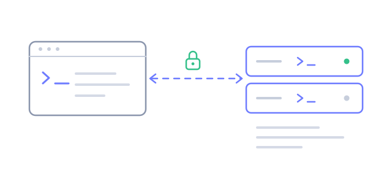

# dsh-ssh-remote

[](https://github.com/topics/dsh-plugin)
[](./LICENSE)
[](./CHANGELOG.md)
[](https://github.com/ShangyuLei-HIT/dsh-ssh-remote/actions/workflows/selftest.yml)

SSH remote development for [DeepSeek Harness](https://github.com/deepseek-ai/deepseek-harness):
manage SSH machines in **Settings**, browse remote directories over SSH, register real
remote **Workspaces**, and let the agent run commands and edit files on the remote host
through a set of typed `remote_*` tools — while the local shell and file tools keep
working on this machine.

中文文档：[README.zh.md](./README.zh.md)



## Features

- **Visual machine management** in **Settings → SSH remote development**: add, edit,
  test and remove machines; connection pills, "Test all", auto-probe on open.
- **Remote directory browser** over SSH: breadcrumbs, home/root/up, typed path, hidden
  directories, inline folder creation, explicit selection.
- **Remote Workspaces**: choosing a machine directory registers a DSH workspace
  (`SSH · machine · path`) that appears in the new-session workspace list. Sessions
  opened there are bound to that remote directory; there the `remote_*` tools default
  to it and the local `bash`/`read`/`write`/`edit`/`glob`/`grep` tools are hidden.
- **Multiplexed SSH transport** with `ControlMaster`/`ControlPersist`, bounded output,
  cooperative cancellation and per-call timeouts.
- **Bilingual UI** (English/中文), host theme tokens, keyboard-accessible dialogs.
- **No DSH package imports**: the bundle loads on any 0.2.2 host without dependency
  resolution tricks.

## Agent tools

| Tool | Purpose |
| --- | --- |
| `remote_status` | Probe a machine: user, hostname, OS, directory, latency, toolchain. Lists configured machines. |
| `remote_exec` | Run a command; returns exit code, stdout, stderr, duration, timeout state. |
| `remote_read` | Read a line window of a remote file plus its total line count. |
| `remote_write` | Create or overwrite a remote file with complete UTF-8 content. |
| `remote_edit` | Replace exact text, refusing ambiguous matches. |
| `remote_grep` | Search remote contents with grep (ERE), skipping `.git`/`node_modules`. |
| `remote_glob` | List remote files by glob (`**` via bash globstar). |
| `remote_upload` / `remote_download` | Move files between this Mac and the remote host. |

Every tool accepts an optional `host` argument (machine id or OpenSSH destination);
without it the tool targets the primary machine, or the machine a remote-workspace
session is bound to.

## Install

### From npm (recommended)

In the DSH Web/Desktop GUI: **Plugins → Add plugin →** enter
`@leishangyu/dsh-ssh-remote`. From a shell with the `dsh` CLI (web profile; the
Desktop profile is managed by the app itself, install through its GUI):

```sh
dsh plugin --profile web add @leishangyu/dsh-ssh-remote
```

### From GitHub

Use the GitHub source when you want the repository head:

```sh
dsh plugin --profile web add github:ShangyuLei-HIT/dsh-ssh-remote
```

### From a local checkout

```sh
git clone https://github.com/ShangyuLei-HIT/dsh-ssh-remote.git
```

Then **Plugins → Add plugin** → choose the cloned directory (or call the `plugin_manager`
tool with the absolute path). Restart/refresh the GUI once so the settings panel loads.

### Custom plugin index

The repository publishes a DSH plugin-market index at
`plugin-market/index.json`. Add its raw URL as an index source
(**Plugins → Discover → Add index source**):

```
https://raw.githubusercontent.com/ShangyuLei-HIT/dsh-ssh-remote/main/plugin-market/index.json
```

## Quick start

1. Make sure the host is reachable non-interactively: key-based login, host key in
   `~/.ssh/config`/`known_hosts`. Run `ssh <host>` once if needed.
2. Open **Settings → SSH remote development** and add a machine: name + OpenSSH
   destination (`~/.ssh/config` alias or `user@host`), then **Browse** to a remote
   directory and **Use this directory**.
3. The workspace `SSH · machine · path` now exists. Create a new session and pick it in
   the workspace list.
4. Ask the agent to work there, e.g. `Run the tests in /srv/app and show the diff`.
   It uses the `remote_*` tools with that directory as the default root.
5. Local sessions are unchanged — remote tools are available there too if you want a
   one-off command.

## How remote Workspaces work

DSH workspaces must name an existing **local** directory (`ctx.workspaceRegistry.create`
canonicalizes it with `fs.realpath`), and the built-in fs/shell tools are host-global.
So, like other remote-workspace plugins, this bundle uses a local **mirror directory**
as the workspace path and records the binding (mirror → machine + remote path):

- `~/.dsh/ssh-remote/machines.json` — machine registry (GUI-managed, wins over the seed
  in `cordis.patch.yml`)
- `~/.dsh/ssh-remote/workspaces.json` — workspace bindings and DSH workspace ids
- `~/.dsh/ssh-remote/workspaces/<machine>/<path>/` — mirror directory (workspace anchor)

The mirror is not a synced copy: remote access always goes through the `remote_*` tools.

## Configuration

The GUI manages machines; the row configuration only seeds a fresh install. For a
manual setup, override the row in your profile patch (`~/.dsh/profiles/desktop/cordis.patch.yml`):

```yaml
- id: ssh-remote
  name: dsh-ssh-remote
  config:
    host: gpu-box          # primary OpenSSH destination
    workspace: /data/work  # primary default directory
    hosts:                 # more machines
      - id: prod
        host: root@10.0.0.30
        workspace: /srv/app
    clearForwardings: true
```

| Field | Default | Meaning |
| --- | --- | --- |
| `host` | `ssh-host` | Primary OpenSSH destination (alias or `user@host`); a fresh install uses this placeholder until a machine is added in Settings. |
| `workspace` | `''` | Primary default remote directory; `''` means the login directory. |
| `hosts` | `[]` | Additional machines: `[{ id, host, workspace? }]`. |
| `sshBinary` | `ssh` | SSH client executable. |
| `remoteShell` | `bash` | Shell for each command. |
| `connectTimeoutSeconds` | `10` | Connect deadline. |
| `defaultTimeoutMs` | `120000` | Default per-call deadline. |
| `maxOutputChars` | `60000` | Per-stream output cap. |
| `maxTransferBytes` | `20000000` | Upload/download/write cap. |
| `maxEditBytes` | `1500000` | Largest file `remote_edit` rewrites. |
| `controlPersistSeconds` | `300` | Multiplexed connection keep-alive. |
| `clearForwardings` | `true` | Ignore `LocalForward`/`RemoteForward` for tool calls. |
| `extraArgs` | `[]` | Extra `ssh` options, e.g. `["-i", "/path/key"]`. |

## Requirements and security

- Linux or macOS remote host; non-interactive key auth; host key already trusted.
- Commands run as your SSH user with no extra approval gate — only configure machines you
  are willing to let the session modify. The settings API binds to loopback and refuses
  cross-origin requests.
- No TTY: interactive programs hang until the call times out.
- DSH 0.2.2-rc.5 was the tested host; the bundle declares `engines.dsh`
  `>=0.2.2-0 <0.3.0`. Newer hosts may work but are unverified.

## Limitations

- The local file sidebar and `@` completion show the empty mirror directory, not the
  remote tree; there is no remote file editor/terminal/Git panel (install
  [`dsh-remote`](https://github.com/flymysql/dsh-remote) for that IDE-like surface).
- No remote language server, debugger or port auto-forwarding.
- Agent instruction files (`AGENTS.md`) are not fetched from the remote tree.
- The settings page uses the generic gear icon in the settings navigation.

## Development

Plain JavaScript, no build step. Node ≥ 22.

```sh
node scripts/selftest.mjs --offline     # manifests, contracts, API, no SSH needed
node scripts/client-selftest.mjs        # client module, slot, dictionaries, renders
node scripts/selftest.mjs --ssh         # + real SSH: probe, exec, browse, session binding
ELECTRON_RUN_AS_NODE=1 "$DSH_NODE_EXECUTABLE" scripts/selftest.mjs --dsh  # running-DSH validators
```

CI runs the two offline suites on Node 22 and 24 (`.github/workflows/selftest.yml`).

Maintainers regenerate the plugin-market index after a release commit:

```sh
node scripts/make-index.mjs
```

## Acknowledgements

The remote-workspace mechanism (local mirror + remote binding + workspace-bound tools,
and hiding native file/shell tools in remote sessions) was inspired by
[`dsh-remote`](https://github.com/flymysql/dsh-remote); this project implements it
independently for a focused, settings-panel-first experience.

## License

MIT © [ShangyuLei-HIT](https://github.com/ShangyuLei-HIT)
