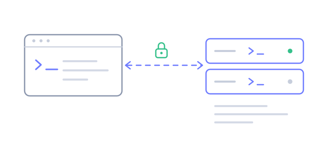

# dsh-ssh-remote

[](https://github.com/topics/dsh-plugin)
[](./LICENSE)
[](./CHANGELOG.md)
[](https://github.com/ShangyuLei-HIT/dsh-ssh-remote/actions/workflows/selftest.yml)

给 [DeepSeek Harness](https://github.com/deepseek-ai/deepseek-harness) 的 SSH 远程开发插件：
在**设置**里可视化管理 SSH 机器、通过 SSH 浏览远程目录、把远程目录注册成真正的**工作区**，
让 Agent 通过一组类型化的 `remote_*` 工具在远端执行命令、读写文件；本机的 shell 与文件工具
继续作用于这台 Mac。

English: [README.md](./README.md)



## 功能

- **可视化机器管理**（设置 → SSH 远程开发机）：添加/编辑/测试/删除机器，连接状态、全部检测、打开页面自动探测。
- **远程目录浏览器**：面包屑、主目录/根目录/上一级、直接输入路径、隐藏目录、新建文件夹、明确的当前选择。
- **远程工作区**：选定目录后自动注册名为 `SSH · 机器 · 路径` 的 DSH 工作区，出现在新建会话的工作区列表；
  在该工作区下新建的会话自动绑定该远程目录，`remote_*` 工具默认工作于此，本地
  `bash`/`read`/`write`/`edit`/`glob`/`grep` 在该会话中隐藏。
- **SSH 连接复用**（`ControlMaster`/`ControlPersist`）、输出上限、可取消、超时控制。
- **中英双语 UI**、宿主主题 token、键盘可操作弹窗。
- **不依赖任何 `@deepseek-ai/dsh-*` 包**，在 0.2.2 宿主上可直接加载。

## Agent 工具

| 工具 | 作用 |
| --- | --- |
| `remote_status` | 探测机器：用户、主机名、系统、目录、延迟、工具链；列出已配置机器。 |
| `remote_exec` | 执行命令，返回退出码、stdout、stderr、耗时、是否超时。 |
| `remote_read` | 读取远程文件的行窗口与总行数。 |
| `remote_write` | 以完整 UTF-8 内容创建/覆盖远程文件。 |
| `remote_edit` | 精确替换文本，二义匹配拒绝执行。 |
| `remote_grep` | grep（ERE）搜索远程内容，跳过 `.git`/`node_modules`。 |
| `remote_glob` | 按 glob 列远程文件（`**` 依赖 bash globstar）。 |
| `remote_upload` / `remote_download` | 本机与远程之间传输文件。 |

所有工具都支持可选 `host` 参数（机器 id 或 OpenSSH 目标）；不填则使用主机器，或在远程工作区
会话中自动使用绑定的那台机器。

## 安装

### 从 npm 安装（推荐）

GUI：**插件 → 添加插件** → 填入 `dsh-remote-ssh-plugin`。
用 `dsh` CLI 时（web profile；桌面版 profile 由应用独占管理，请在 GUI 安装）：

```sh
dsh plugin --profile web add dsh-remote-ssh-plugin
```

### 从 GitHub 安装

需要仓库最新代码时使用：

```sh
dsh plugin --profile web add github:ShangyuLei-HIT/dsh-ssh-remote
```

### 从本地目录安装

```sh
git clone https://github.com/ShangyuLei-HIT/dsh-ssh-remote.git
```

然后 **插件 → 添加插件** 选择该目录（或用 `plugin_manager` 工具传绝对路径），重启/刷新 GUI 一次
以加载设置面板。

### 自定义插件索引

仓库附带 DSH 插件市场索引 `plugin-market/index.json`，可在
**插件 → Discover → 添加索引源** 中填写其原始 URL：

```
https://raw.githubusercontent.com/ShangyuLei-HIT/dsh-ssh-remote/main/plugin-market/index.json
```

## 快速上手

1. 确保主机可以免交互登录（密钥认证、主机指纹已在 `known_hosts`；必要时先手动 `ssh <host>` 一次）。
2. 打开 **设置 → SSH 远程开发机** → 添加机器（名称 + `~/.ssh/config` 别名或 `user@host`）→
   **浏览目录** 选一个远程目录 → **用这个目录**。
3. 此时工作区列表中出现 `SSH · 机器 · 路径`；新建会话时选择它。
4. 在对话里直接说“在 /srv/app 里跑测试并看下 diff”，Agent 会用 `remote_*` 工具以该目录为根工作。
5. 普通本地会话不受影响；需要临时远程操作时也可以直接用这些工具。

## 远程工作区是怎么实现的

DSH 的工作区必须指向一个**已存在的本地目录**（`ctx.workspaceRegistry.create` 会用 `fs.realpath`
规范化），且内置 fs/shell 工具是宿主全局的。因此本插件和其它远程工作区插件一样，使用
“本地镜像目录作为工作区路径 + 记录绑定（镜像 → 机器 + 远程目录）”的方式：

- `~/.dsh/ssh-remote/machines.json` — 机器注册表（GUI 管理，优先于 `cordis.patch.yml` 的种子配置）
- `~/.dsh/ssh-remote/workspaces.json` — 工作区绑定与 DSH 工作区 id
- `~/.dsh/ssh-remote/workspaces/<机器>/<路径>/` — 镜像目录（工作区锚点）

镜像不会同步文件；远程访问始终通过 `remote_*` 工具完成。

## 配置

日常用 GUI 即可；行配置只在新装时作为种子。手工配置时在
`~/.dsh/profiles/desktop/cordis.patch.yml` 覆盖该行：

```yaml
- id: ssh-remote
  name: dsh-ssh-remote
  config:
    host: gpu-box          # 主机器 OpenSSH 目标
    workspace: /data/work  # 主机器默认目录
    hosts:                 # 更多机器
      - id: prod
        host: root@10.0.0.30
        workspace: /srv/app
    clearForwardings: true
```

| 字段 | 默认值 | 含义 |
| --- | --- | --- |
| `host` | `ssh-host` | 主机器 OpenSSH 目标（别名或 `user@host`）；全新安装时是占位值，在设置里添加机器后以设置为准。 |
| `workspace` | `''` | 主机器默认远程目录；空串表示登录目录。 |
| `hosts` | `[]` | 追加机器：`[{ id, host, workspace? }]`。 |
| `sshBinary` | `ssh` | SSH 客户端可执行文件。 |
| `remoteShell` | `bash` | 每次命令使用的 shell。 |
| `connectTimeoutSeconds` | `10` | 连接超时。 |
| `defaultTimeoutMs` | `120000` | 单次调用默认超时。 |
| `maxOutputChars` | `60000` | 每路输出上限。 |
| `maxTransferBytes` | `20000000` | 上传/下载/写入上限。 |
| `maxEditBytes` | `1500000` | `remote_edit` 允许重写的最大文件。 |
| `controlPersistSeconds` | `300` | 多路复用连接保活时长。 |
| `clearForwardings` | `true` | 工具调用忽略 `LocalForward`/`RemoteForward`。 |
| `extraArgs` | `[]` | 追加 ssh 参数，如 `["-i", "/path/key"]`。 |

## 要求与安全

- 远端为 Linux 或 macOS；免交互密钥认证；主机指纹已信任。
- 命令以你的 SSH 用户身份执行，没有额外审批门禁——只配置你允许会话修改的机器。
  设置接口只监听回环地址并拒绝跨站请求。
- 没有 TTY：交互式程序会挂起直到超时。
- 已在 DSH 0.2.2-rc.5 上验证；`engines.dsh` 声明 `>=0.2.2-0 <0.3.0`，更新版本未验证。

## 已知限制

- 本地文件侧边栏与 `@` 补全看到的是空的镜像目录，不是远程文件树；没有远程编辑器/终端/Git 面板
  （需要这类 IDE 体验可安装 [`dsh-remote`](https://github.com/flymysql/dsh-remote)）。
- 没有远程语言服务、调试器、端口自动转发。
- 不会从远程读取 `AGENTS.md`。
- 设置导航使用通用齿轮图标。

## 开发

纯 JavaScript，无构建步骤，Node ≥ 22。

```sh
node scripts/selftest.mjs --offline     # 清单/契约/API，无需 SSH
node scripts/client-selftest.mjs        # 客户端模块、slot、字典、组件渲染
node scripts/selftest.mjs --ssh         # 追加真实 SSH：探测、执行、浏览、会话绑定
ELECTRON_RUN_AS_NODE=1 "$DSH_NODE_EXECUTABLE" scripts/selftest.mjs --dsh  # 运行中 DSH 校验器
```

CI 在 Node 22/24 上跑两个离线套件（`.github/workflows/selftest.yml`）。

发布后维护者重新生成插件市场索引：

```sh
node scripts/make-index.mjs
```

## 致谢

“本地镜像 + 远程绑定 + 工作区绑定工具、在远程会话隐藏本地文件/shell 工具”的思路参考了
[`dsh-remote`](https://github.com/flymysql/dsh-remote)；本项目为其独立实现，聚焦设置面板优先的体验。

## 许可

MIT © [ShangyuLei-HIT](https://github.com/ShangyuLei-HIT)
